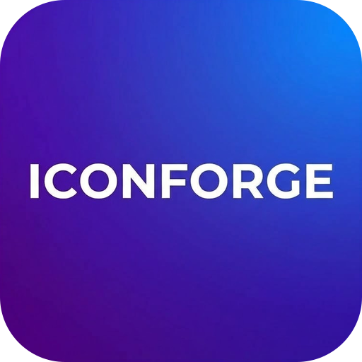
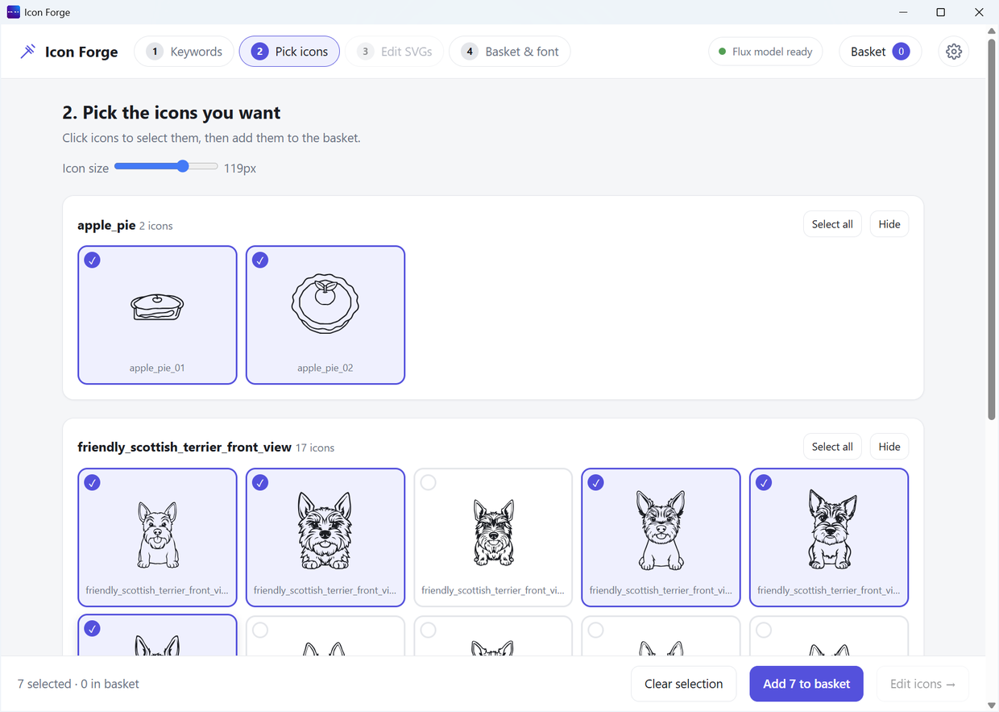

# Icon Forge

**Type a word. Get a set of icons. Turn them into an icon font.**
It all happens on your own PC. No account. No cloud.



## Why use it

- **Free.** No subscription, no credits, no sign-up.
- **Private.** The pictures are made on your PC. Your words never leave it.
- **Works offline.** You go online once, to download the AI model.
- **One installer.** No Python, no ComfyUI.
- **Clean SVG icons.** Sharp at any size. You can change the colour.
- **Fix them before you use them.** Flip, turn, resize, move, delete stray dots.
- **Icon font in one click.** `.ttf`, `.woff`, `.woff2`, a `.css` file and a preview page.

## Get it

1. Download **Icon Forge Setup** from the [Releases](../../releases) page.
2. Run it. If Windows says "Windows protected your PC", click **More info**, then **Run anyway**. (The installer is not signed yet.)
3. Follow the [first start guide](../../wiki/First-Start). You download the AI model once (17.2 GB).

You need Windows 10 or 11 (64-bit), a graphics card that supports Vulkan, and about 20 GB of free disk space.

## Help and guides

Everything is explained in simple words on the **[Wiki](../../wiki)**:
[Installation](../../wiki/Installation) · [Download the model](../../wiki/Download-the-Model) · [Make icons](../../wiki/Step-1-Keywords) · [Use your font](../../wiki/Use-Your-Font) · [Troubleshooting](../../wiki/Troubleshooting) · [FAQ](../../wiki/FAQ)

## Build it yourself

You need [Node.js](https://nodejs.org/) (version 24 was used) and Windows.

```bash
npm install
npm run engine   # downloads the image engine (about 30 MB) into ./engine
npm start        # runs the app
npm run dist     # builds the installer into ./dist
```

The image engine is not stored in this repository. It is a separate open-source program, so `npm run engine` downloads the exact version the app was tested with.

### How it is put together

| Part | What it does |
|---|---|
| `main.js` | The app window and the purple welcome screen |
| `server.js` | A small local server that the window talks to (this PC only) |
| `generate.js` | Starts the image engine and draws the icons |
| `modelstore.js` | Finds and downloads the AI model |
| `svgedit.js` | Flip, resize and delete-shape edits |
| `fontmaker.js` | Builds the icon font files |
| `public/` | The screens you see |
| `wiki/` | The pages of the project wiki |

## Credits

Icon Forge is built on other people's open work:
**FLUX.1 [schnell]** by Black Forest Labs (Apache 2.0), **stable-diffusion.cpp** by leejet and contributors (MIT), **VTracer** by Vision Cortex (MIT), **Electron** (MIT), and the font tools svg2ttf, ttf2woff and wawoff2.
See [Credits and licences](../../wiki/Credits-and-Licences).
