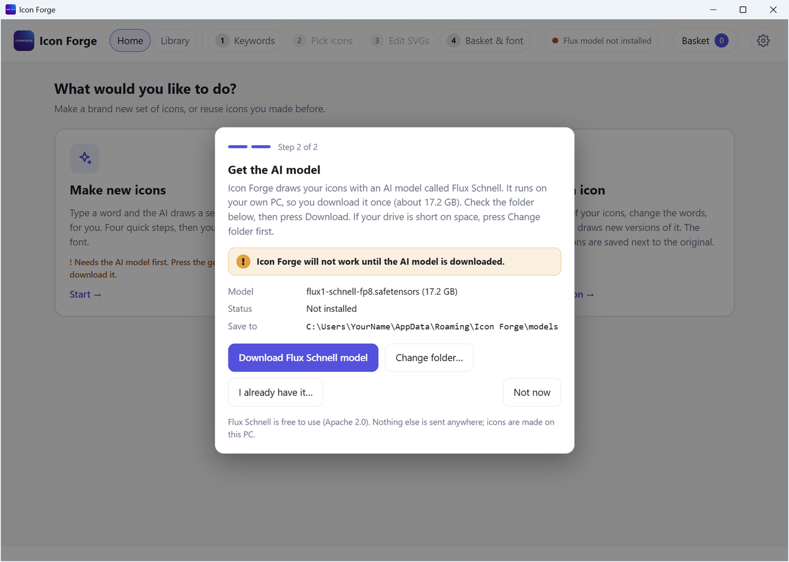
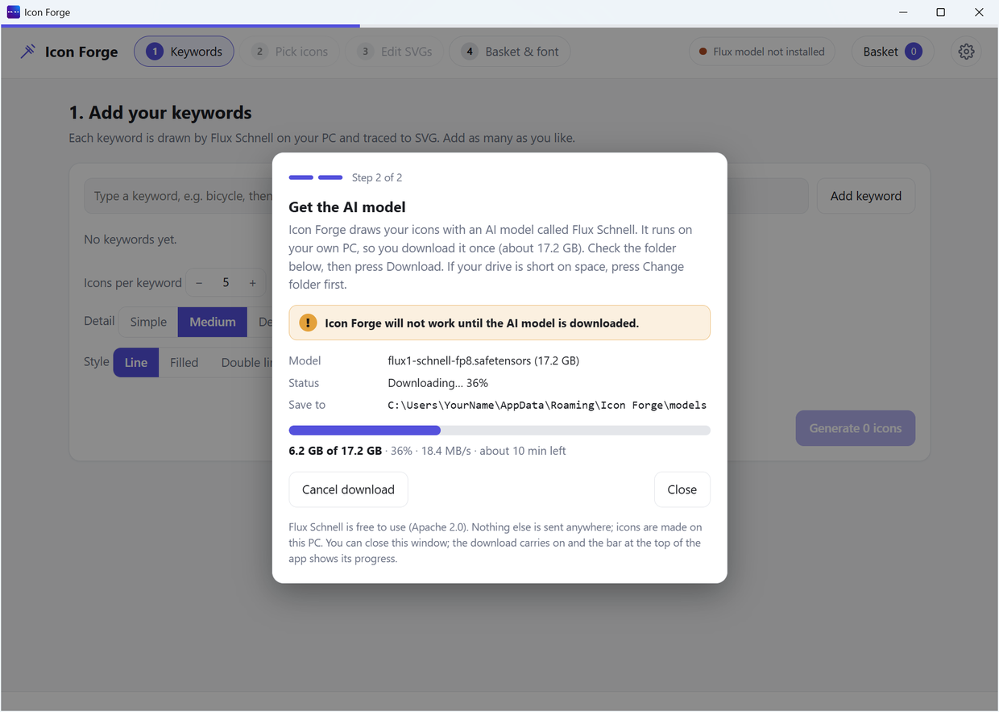
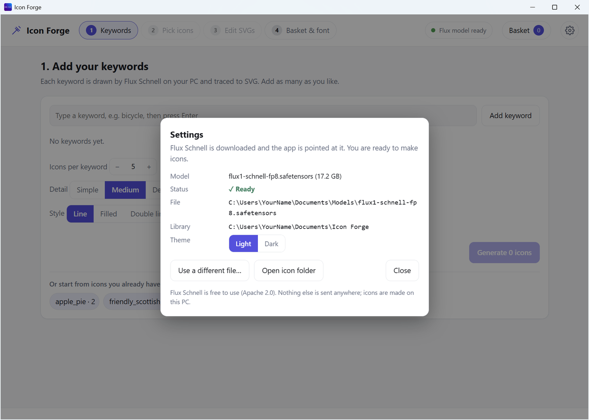

# Download the model

The model is the AI "brain" that draws your icons. It is called **Flux Schnell**.

- It is one file of about **17.2 GB**.
- You download it **once**.
- After that, Icon Forge works offline.

## Pick one of two ways

| You... | Press | What happens |
|---|---|---|
| Do not have the model | **Download Flux Schnell model** | Icon Forge downloads it for you. |
| Already have `flux1-schnell-fp8.safetensors` | **I already have it…** | You pick the file. Icon Forge uses it. Nothing is downloaded. |

## Download it

| Step | What to do |
|---|---|
| 1 | Open **Settings** (the gear at the top right). It opens by itself if the model is missing. |
| 2 | Look at **Save to**. That is the folder the model goes into. |
| 3 | Want a different folder? Press **Change folder…** and choose one. |
| 4 | Press **Download Flux Schnell model**. |

## Watch the progress

While it downloads you see:

- A big bar and the percent done
- How much is downloaded, like "6.2 GB of 17.2 GB"
- The speed
- About how long is left

A thin bar also shows at the very top of the app. You can close the Settings window. The download keeps going.

## When it finishes

- Icon Forge shows **"Flux model downloaded and ready"**.
- It points itself at the new file. You do nothing.
- The status at the top turns green: **Flux model ready**.

## Things that can happen

| What | What Icon Forge does |
|---|---|
| Not enough space on the drive | It tells you. Choose another folder. |
| Your internet drops | The download stops. Press **Download** again and it carries on from where it stopped. |
| You press **Cancel download** | It stops. Press **Download** later to carry on. |

## Next

[Step 1: Keywords](Step-1-Keywords.md)
