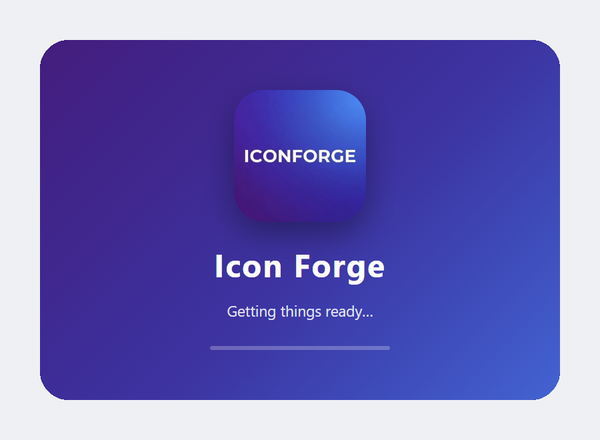
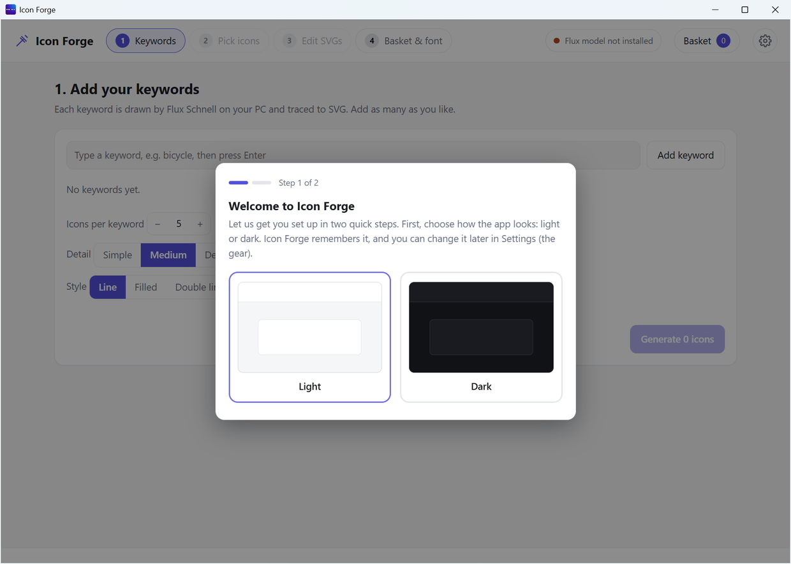
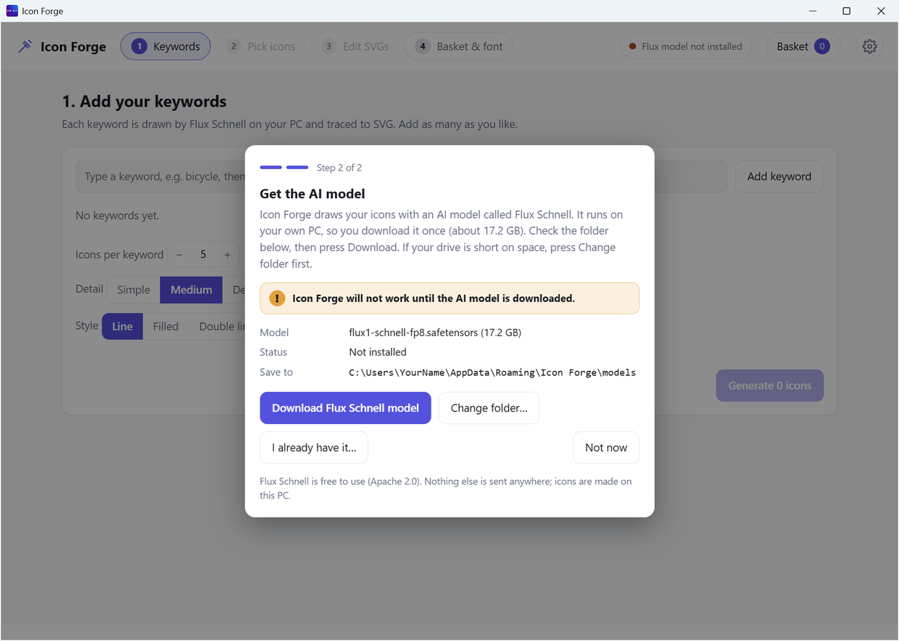
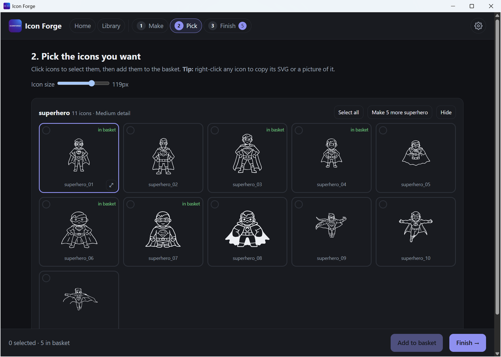

# First start

The first time you open Icon Forge, it walks you through two quick steps. Only one window is open at a time.

| Order | What you see | What you do |
|---|---|---|
| 0 | A purple welcome screen | Nothing. It closes by itself. |
| 1 | **Step 1 of 2: Welcome** | Pick Light or Dark. |
| 2 | **Step 2 of 2: Get the AI model** | Press **Download**. See [Download the model](Download-the-Model). |

## 1. The welcome screen

A purple screen with the Icon Forge icon and name. It shows for about two seconds while the app gets ready.

## Step 1 of 2: Choose your look

- Pick **Light** or **Dark**.
- Icon Forge remembers your choice. It will not ask again.
- You can change it later in [Settings](Settings).
- When you pick, the window goes straight to step 2.

## Step 2 of 2: Get the AI model

Icon Forge needs the AI model before it can draw. This window tells you what it is and how big it is (17.2 GB).

- An orange box tells you that Icon Forge will not work until the model is downloaded.
- Press **Download Flux Schnell model** to download it. The bar shows the speed and the time left.
- Press **Change folder…** first if your drive is short on space.
- Press **I already have it…** if you have the file already.
- When it is done, press **Start making icons**.
- Press **Not now** to skip. The window comes back next time you open the app, until the model is ready.

Go to [Download the model](Download-the-Model) for more detail.

## Dark theme

Here is the same app in dark.

