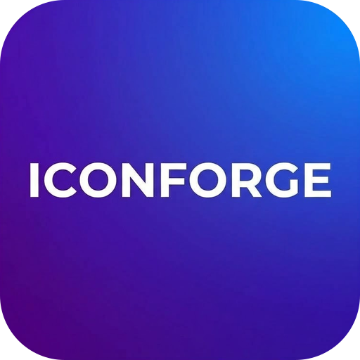
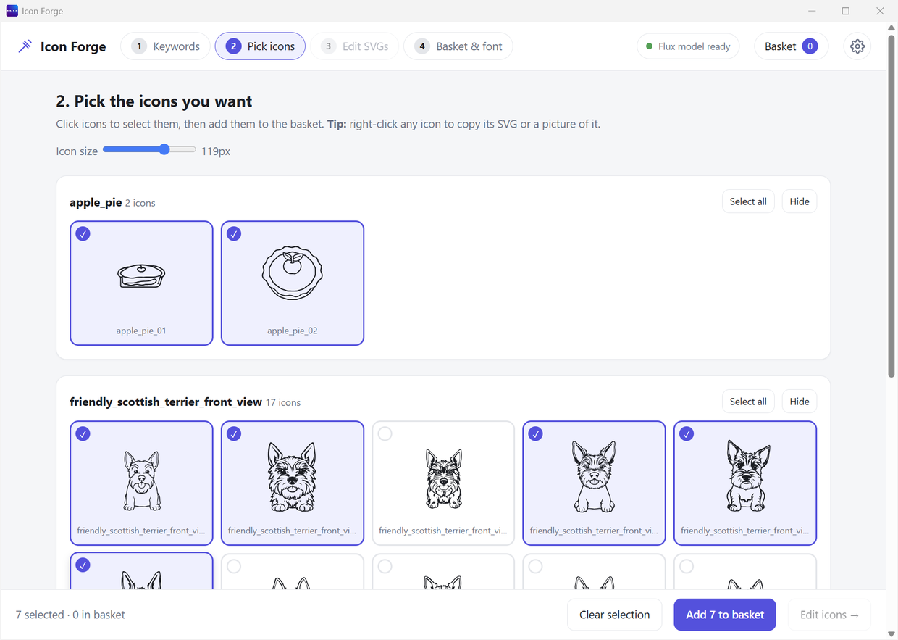

# Icon Forge

**Type a word. Get a set of icons. Turn them into an icon font.**
It all happens on your own PC. No account. No cloud.

## Why use Icon Forge?

| Benefit | What it means for you |
|---|---|
| **Free** | No subscription, no credits, no sign-up. |
| **Private** | The pictures are made on your PC. Your words are never sent anywhere. |
| **Works offline** | You go online once, to download the AI model. After that you can be offline. |
| **One installer** | No Python. No extra tools to set up. Install, start, draw. |
| **Many icons fast** | Type a few words. Get five icons for each one. |
| **Clean icons** | Every icon is an SVG. It stays sharp at any size. You can change its colour. |
| **Fix them before you use them** | Flip, turn, resize, move, or delete stray dots. |
| **Copy with one right-click** | Right-click any icon. Copy its SVG, or a picture (PNG), and paste it anywhere. |
| **Icon font in one click** | You get `.ttf`, `.woff`, `.woff2`, a `.css` file and a preview page. |

## How it works

There are four steps. The top of the app shows them.

| Step | What you do | What you get |
|---|---|---|
| [1. Keywords](Step-1-Keywords) | Type words like `apple pie` or `scottish terrier`. Press Generate. | A folder of SVG icons for each word |
| [2. Pick icons](Step-2-Pick-Icons) | Click the ones you like. | A basket of favourites |
| [3. Edit SVGs](Step-3-Edit-SVGs) | Flip, resize, or clean up. This step is optional. | Tidier icons |
| [4. Basket and font](Step-4-Basket-and-Font) | Name your font. Press Create. | An icon font you can use on a website |

## What you need

| Need | Details |
|---|---|
| Windows | Windows 10 or 11, 64-bit |
| Graphics card | Any card that supports Vulkan. NVIDIA, AMD and Intel cards usually do. |
| Free disk space | About 20 GB. The AI model alone is 17.2 GB. |
| Memory (RAM) | 32 GB is best. This is what we tested with. |
| Internet | Only once, to download the model |

**Tested on:** Windows 11, 32 GB RAM, an 8 GB NVIDIA laptop graphics card.
**Speed there:** about 40 seconds for one icon. The first icon of each session takes about a minute longer. A weaker card will be slower.

## Good to know

- Windows only for now.
- The installer is not signed yet. Windows will show a warning. [Here is what to click](Installation).
- The AI draws the pictures, so some icons look odd. That is normal. You pick the good ones in step 2.

## Start here

1. [Install Icon Forge](Installation)
2. [First start](First-Start)
3. [Download the model](Download-the-Model)
4. [Make your first icons](Step-1-Keywords)

Stuck? See [Troubleshooting](Troubleshooting) or the [FAQ](FAQ).
