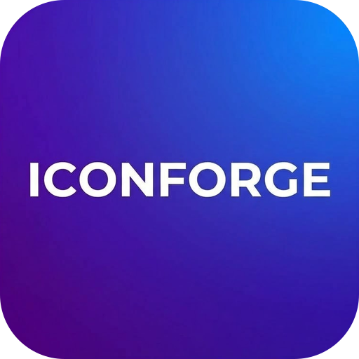
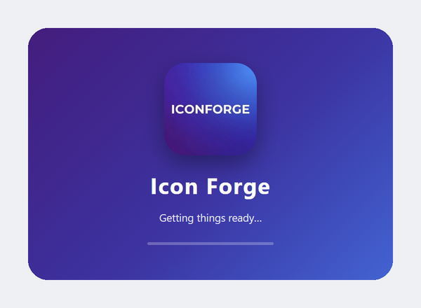

# Installation

Installing takes about two minutes.

## Before you start

- You need Windows 10 or 11 (64-bit).
- You need about 20 GB of free disk space. [More details](Home#what-you-need).

## Install it

| Step | What to do |
|---|---|
| 1 | Download **Icon Forge Setup 1.0.0.exe** from the **Releases** page of this project. |
| 2 | Double-click the file. |
| 3 | If Windows says **"Windows protected your PC"**, click **More info**, then **Run anyway**. (Why? See below.) |
| 4 | Follow the steps on screen. You can keep the default folder. |
| 5 | Press **Finish**. Icon Forge starts. |

## Why does Windows show a warning?

- The installer is not signed yet.
- Signing costs money. Without it, Windows warns about every new app.
- The warning is about the missing signature. It is not a problem found in the app.

## After you install

- You find Icon Forge in the Start menu and on your desktop. It looks like this:

- Icon Forge starts with a short purple welcome screen.
- Next: [First start](First-Start).

## Update to a newer version

1. Close Icon Forge.
2. Run the new installer.
3. Your icons, fonts, settings and model are kept.

## Uninstall

1. Open **Windows Settings**, then **Apps**.
2. Find **Icon Forge**. Press **Uninstall**.

What is **not** deleted:

| What | Where | Why keep it |
|---|---|---|
| Your icons and fonts | `Documents\Icon Forge` | They are your work. |
| The AI model | `AppData\Roaming\Icon Forge\models` (or the folder you chose) | It is 17.2 GB. Delete it yourself if you want the space back. |
