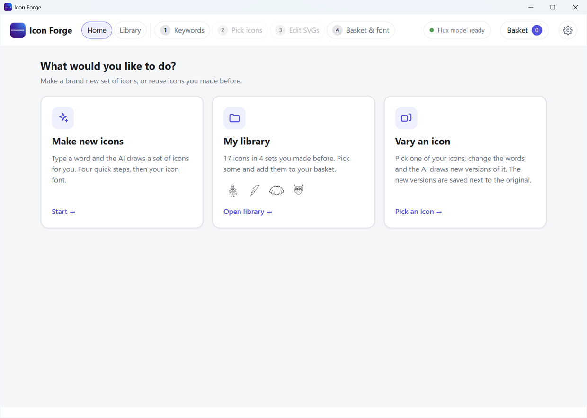
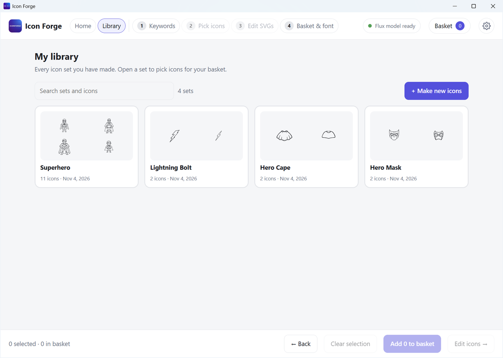
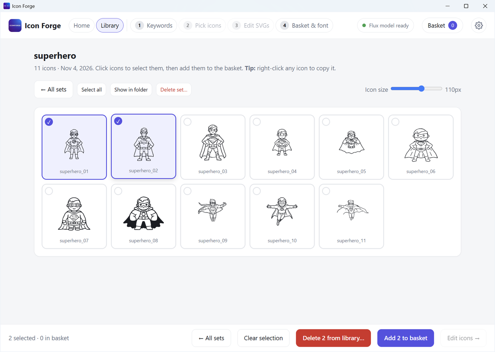
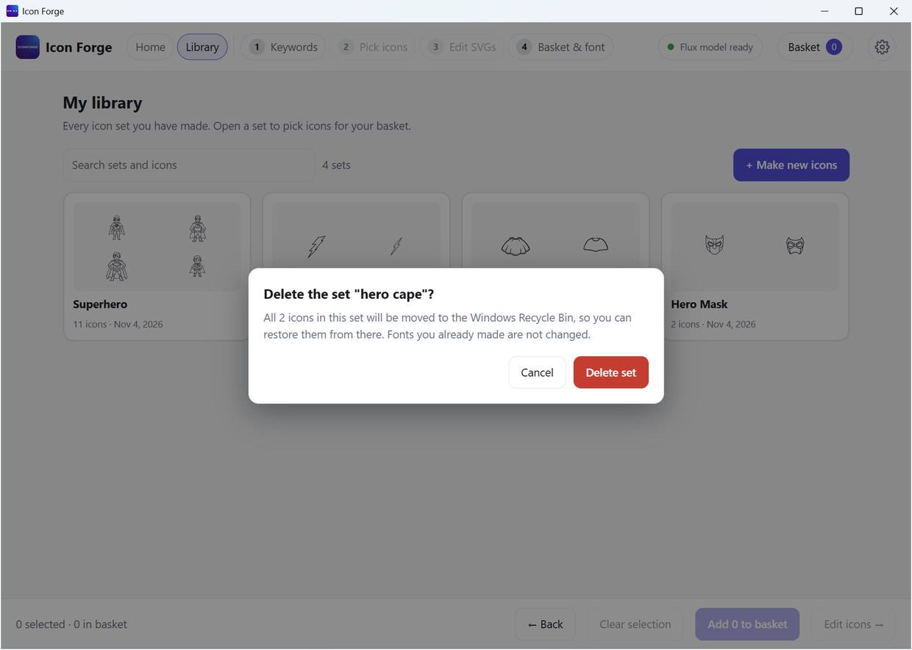

# Home and Library

When Icon Forge opens, you land on the **Home** screen. It asks: *What would you like to do?*

| Tile | What it does |
|---|---|
| **Make new icons** | Starts the four steps, from [Step 1: Keywords](Step-1-Keywords) |
| **My library** | Opens every icon set you made before |
| **Vary an icon** | Opens the library so you can pick one icon and change it. See [Vary an icon](Vary-an-Icon). |

If you already have icons in your basket, a strip at the bottom says so. Press **Open basket** to carry on.

Click the **Icon Forge logo** at the top left any time to come back to Home.

## My library

The library shows every set of icons you made. Each set is a card with four small icons, its name, how many icons it has and the date.

| What you want | What to do |
|---|---|
| Find a set | Type in the **search box**. It looks at set names and icon names. |
| Open a set | Click its card |
| Make a new set | Press **+ Make new icons** |
| Delete a whole set | Move the mouse over a card. Press the small **bin**. See [Delete from the library](#delete-from-the-library). |

Sets are shown newest first.

## Inside a set

| Button | What it does |
|---|---|
| **← All sets** | Back to the list of sets |
| **Select all** | Selects every icon in the set |
| **Show in folder** | Opens the set's folder in Windows |
| **Delete set…** | Moves the whole set to the Recycle Bin |
| **Icon size** slider | Makes the icons bigger or smaller on screen |

Click icons to select them. You can select icons from several sets. Then use the bar at the bottom:

| Button | What it does |
|---|---|
| **Clear selection** | Unselects everything |
| **Remove N from basket** | Shown if some selected icons are already in your basket |
| **Delete N from library…** | Moves the selected icons to the Recycle Bin |
| **Vary this icon…** | Shown when exactly one icon is selected. See [Vary an icon](Vary-an-Icon). |
| **Add N to basket** | Puts the selected icons in your basket |
| **Edit icons →** | Goes to [Step 3](Step-3-Edit-SVGs) |

**Right-click** an icon for **Copy SVG**, **Copy as picture (PNG)**, **Vary this icon…** and **Delete from library…**.

## Delete from the library

Deleting is safe. Icon Forge never erases files for good. It moves them to the **Windows Recycle Bin**, so you can restore them from there.

- Before anything is moved, a box asks you to confirm. It says what will go.
- **Cancel** has the focus, so pressing Enter does not delete by accident. **Escape** cancels too.
- If a deleted icon is in your basket, it is taken out of the basket as well.
- Fonts you already made are not changed.
- If you delete the last icon of a set, the empty set is removed too.

Removing an icon from the **basket** is different. It only takes it out of the basket. The file stays in your library.
