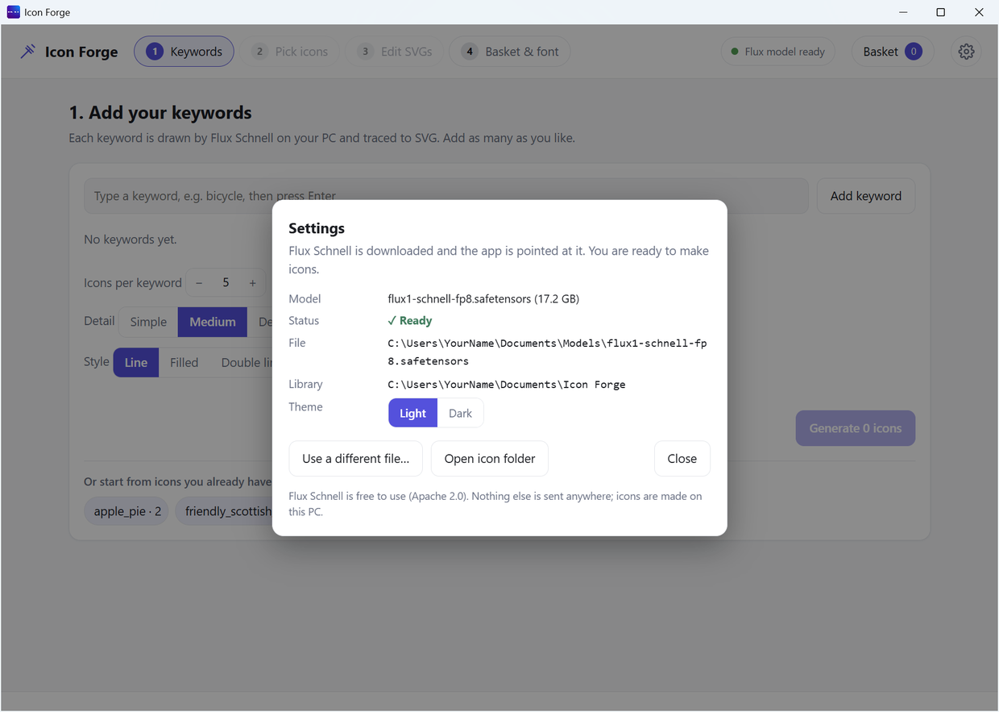

# Settings

Open Settings with the **gear** at the top right. A small dot on the gear shows the model status (see below).

## What is in Settings

| Row | What it shows |
|---|---|
| **Model** | The name and size of the AI model |
| **Status** | Ready, Downloading, or Not installed |
| **File** (or **Save to**) | Where the model file is. If it is not installed yet, this is the folder it will download into. |
| **Library** | The folder where your icons and fonts are saved |
| **Theme** | Light or Dark. Until you click one, Icon Forge follows Windows. Your click is saved. |

## Buttons

| Button | When you see it | What it does |
|---|---|---|
| **Download Flux Schnell model** | Model not installed | Starts the download. See [Download the model](Download-the-Model.md). |
| **Change folder…** | Model not installed | Choose where the model is saved |
| **I already have it…** | Model not installed | Pick a model file you already have |
| **Use a different file…** | Model ready | Switch to another copy of the model |
| **Cancel download** | While downloading | Stops the download. You can carry on later. |
| **Open icon folder** | Always | Opens your library folder in Windows |
| **Close** | Always | Closes Settings. A download keeps going. |

## The dot on the gear

| What you see | Meaning |
|---|---|
| Orange dot | The AI model is not installed. Download it first. |
| Pulsing dot | The model is downloading. Point at the gear to see the percent and the speed. |
| No dot | The model is ready. You can make icons. |
