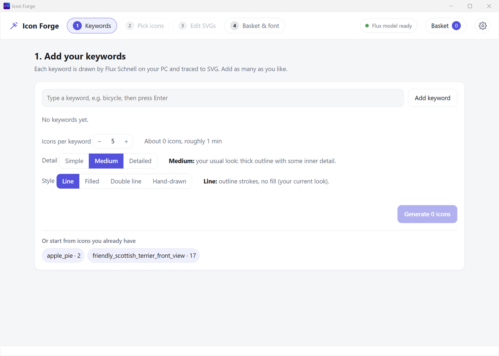
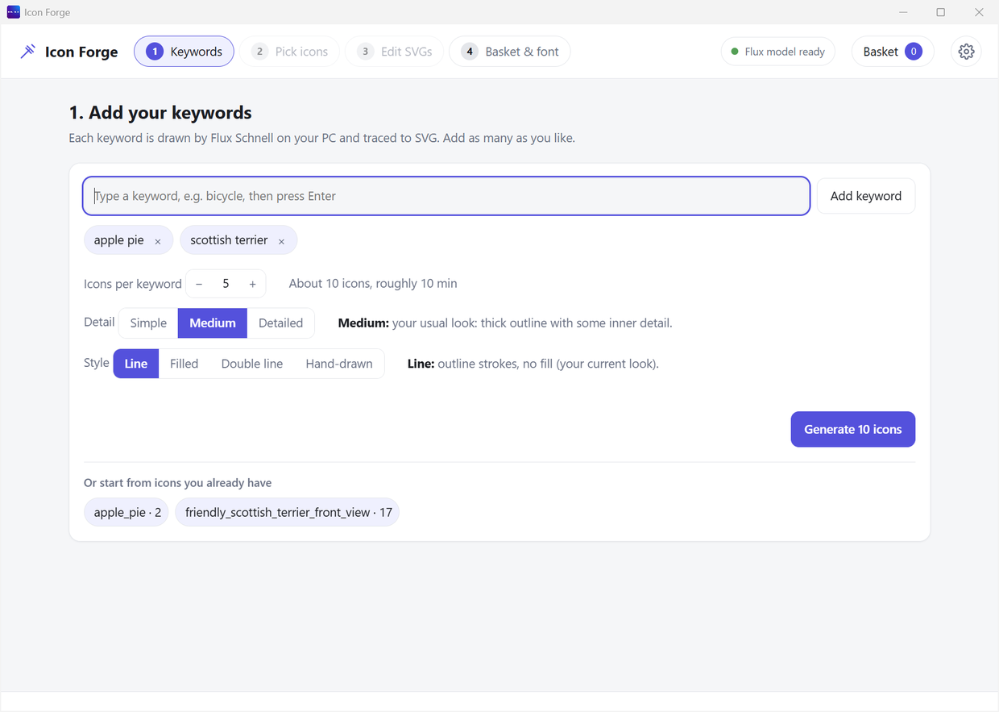
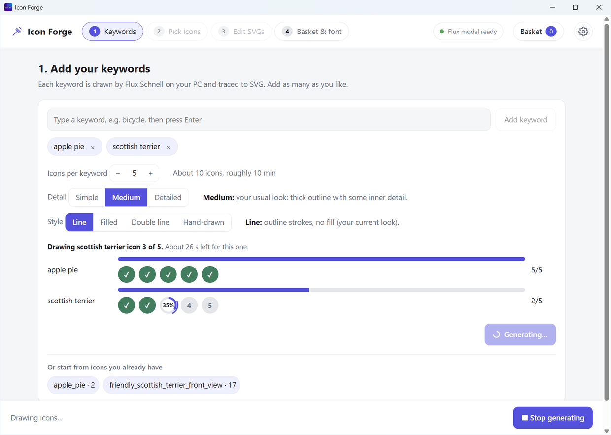

# Step 1: Keywords

Tell Icon Forge what to draw. Each word becomes a set of icons.

## Add your words

| Step | What to do |
|---|---|
| 1 | Click the box. Type a word, like `apple pie`. |
| 2 | Press **Enter**. The word appears as a little tag. |
| 3 | Add more words the same way. You can also type `apple pie, scottish terrier` and press Enter. |
| 4 | Made a mistake? Click the **×** on a tag. |

Tip: simple, single things work best. "scottish terrier" works better than "a scottish terrier chasing a ball at night".

## Choose how they look

| Setting | Choices | What it does |
|---|---|---|
| **Icons per keyword** | 1 to 24 (starts at 5) | How many icons you get for each word |
| **Detail** | Simple, Medium, Detailed | Simple has thick lines and few shapes. It is best for small icons. Detailed has fine lines. It is best for big icons, and it is slower. |
| **Style** | Line, Filled, Double line, Hand-drawn | Line is an outline. Filled is a solid shape. Double line is an outline with a thin line inside. Hand-drawn is wobbly and friendly. |

Under the settings you see how many icons you will get and about how long it takes.

## Press Generate

Press **Generate** in the bar at the bottom. It says how many icons you will get. **← Back** next to it goes back to Home. Now Icon Forge draws.

| What you see | What it means |
|---|---|
| A message at the top of the list | What Icon Forge is doing right now |
| A row for each word | The progress of that word |
| A ring for each icon | Grey = waiting. Spinning ring with a percent = drawing now. Green tick = done. Red cross = did not finish. |
| A thin bar above the rings | The progress for the whole word |

### The first icon takes longer

- Icon Forge has to load the 17 GB model first.
- That takes about a minute extra.
- The next icons are quicker.

### Want to stop?

- Press **Stop generating** at the bottom.
- Icons that are already drawn are kept.

## When it is done

- Icon Forge moves you to [Step 2](Step-2-Pick-Icons.md).
- Your icons are saved as SVG files. See [Your files](Your-Files.md).

## Start from icons you already have

Under the settings you may see **"Or start from icons you already have"**. Each tag is a folder of icons from before. Click one to jump straight to [Step 2](Step-2-Pick-Icons.md).

## Notes

- Each word gets its own folder. `apple pie` makes a folder called `apple_pie`.
- A style other than Line adds its name: `apple_pie_filled`.
- Drawing more of the same word adds new icons. Old ones are never overwritten.
- Letters, numbers, spaces and dashes work in words. Other characters are removed.
