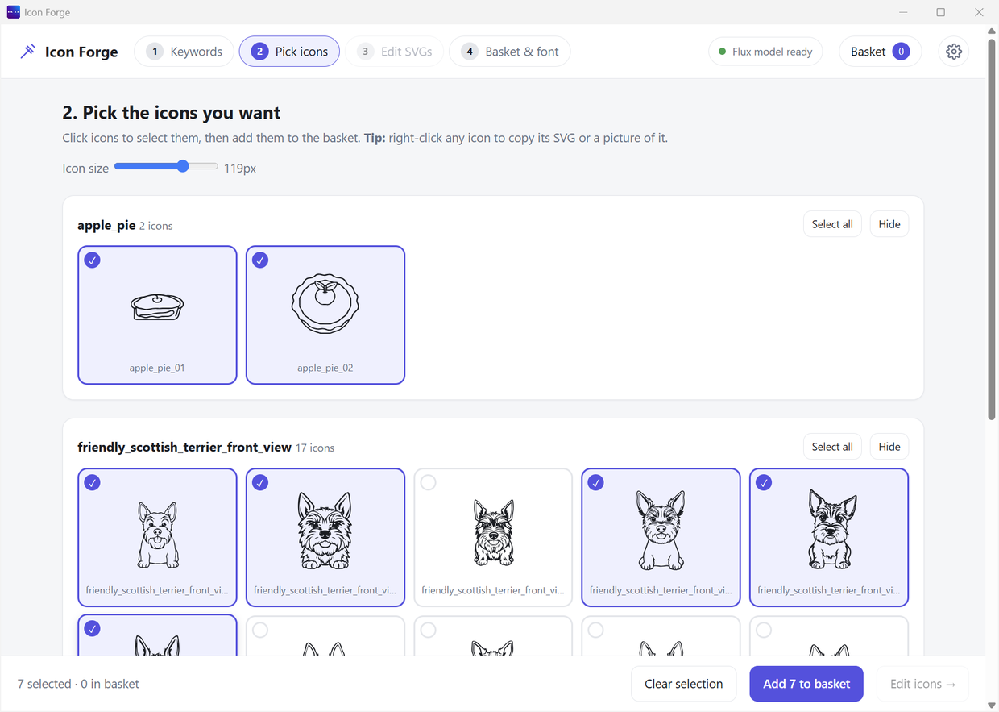

# Step 2: Pick icons

Not every icon will be perfect. This step is where you choose the good ones.

## Choose your favourites

| Step | What to do |
|---|---|
| 1 | Click an icon. A tick shows. It is now selected. |
| 2 | Click it again to unselect it. |
| 3 | Press **Add N to basket** at the bottom. (N is how many you selected.) |

## Tools on this page

| Button | What it does |
|---|---|
| **Select all** | Selects every icon in that set |
| **Make 5 more** | Draws more icons for the same word (needs the model ready) |
| **Hide** | Hides that set from this page. Your files stay safe. |
| **Icon size** slider | Makes the icons bigger or smaller on screen. It does not change the icons. |

## The bar at the bottom

| Button | What it does |
|---|---|
| **← Back** | Goes back to [Step 1](Step-1-Keywords.md) |
| **Clear selection** | Unselects everything |
| **Remove N from basket** | Shown when some selected icons are already in your basket. It takes them out of the basket. |
| **Vary this icon…** | Shown when exactly one icon is selected. See [Vary an icon](Vary-an-Icon.md). |
| **Add N to basket** | Puts the selected icons in your basket. Icons already there are not added twice. |
| **Edit icons →** | Goes to [Step 3](Step-3-Edit-SVGs.md) |

## Good to know

- An icon already in your basket shows an **"in basket"** label.
- The bottom bar shows how many icons you selected and how many are in the basket.
- You can mix icons from different words in one basket.
- **Right-click** any icon to copy it, or to vary it. See [Copy an icon](Step-4-Basket-and-Font.md#copy-a-single-icon).
- Want icons from an older set? Open the [library](Library.md) and pick from there.

## Next

[Step 3: Edit SVGs](Step-3-Edit-SVGs.md) is optional. You can also jump to [Step 4](Step-4-Basket-and-Font.md).
