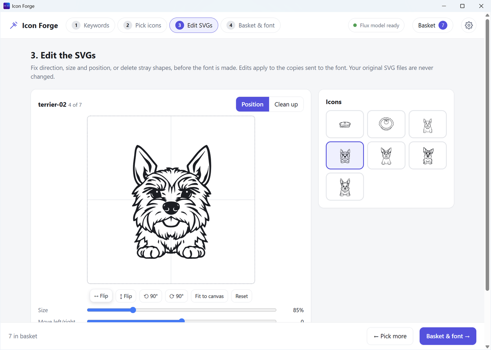
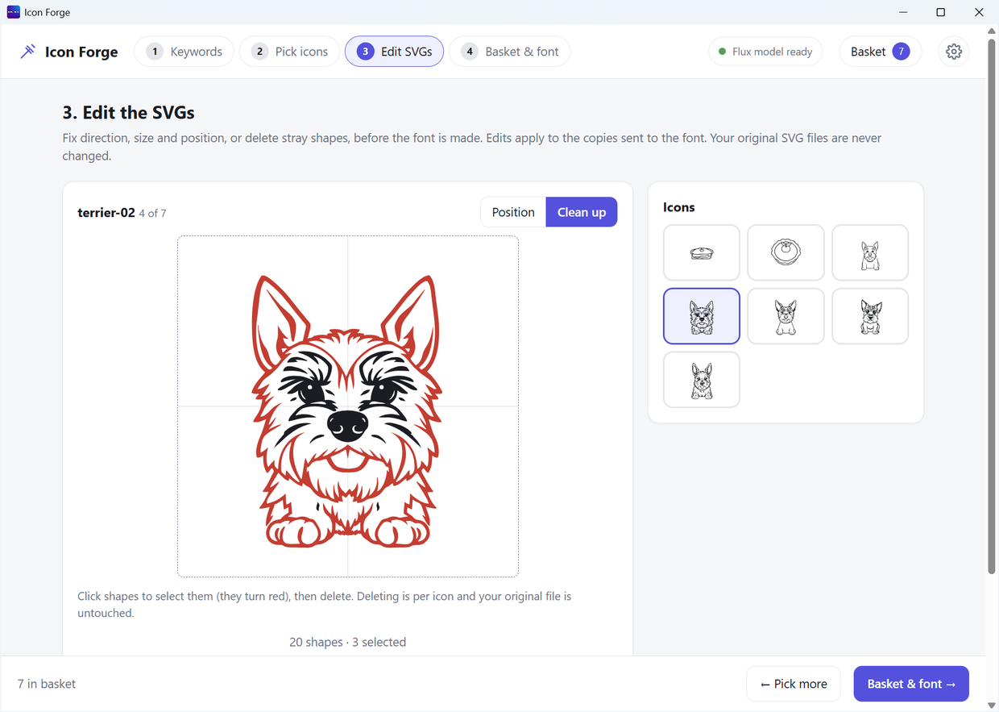

# Step 3: Edit SVGs

Fix small problems before you make the font. This step is optional.

**Your original SVG files are never changed.** Your edits only apply to the copies that go into the font.

## Pick an icon

- The big box shows the icon you are editing.
- The small icons on the right are your basket. Click one to edit it.
- There are two modes: **Position** and **Clean up**.

## Position mode

Use this to turn, flip, resize or move an icon.

| Control | What it does |
|---|---|
| **↔ Flip** | Mirrors left and right |
| **↕ Flip** | Mirrors up and down |
| **⟲ 90° / ⟳ 90°** | Turns the icon a quarter turn |
| **Fit to canvas** | Makes the icon fill the box nicely |
| **Reset** | Puts it back how it was |
| **Size** slider | 50% to 200% |
| **Move left/right** and **Move up/down** | Slide the icon around |
| **Apply these edits to all icons** | Copies the same edits to every icon in the basket |
| **Fit all to canvas** | Fits every icon at once |

## Clean up mode

Use this to remove stray dots and bits you do not want.

| Step | What to do |
|---|---|
| 1 | Click **Clean up**. |
| 2 | Click a shape. It turns **red**. Click more shapes if you want. |
| 3 | Press **Delete selected**. |

More tools:

| Button | What it does |
|---|---|
| **Undo** | Brings back the last thing you deleted |
| **Restore all** | Brings back everything you deleted from this icon |
| **Clear selection** | Unselects the red shapes |
| **Speck size** slider and **Select shapes smaller than this** | Finds tiny dots for you. Then press Delete. |

## Next

- Press **Basket & font →** at the bottom.
- Or press **← Pick more** to go back and add more icons.
