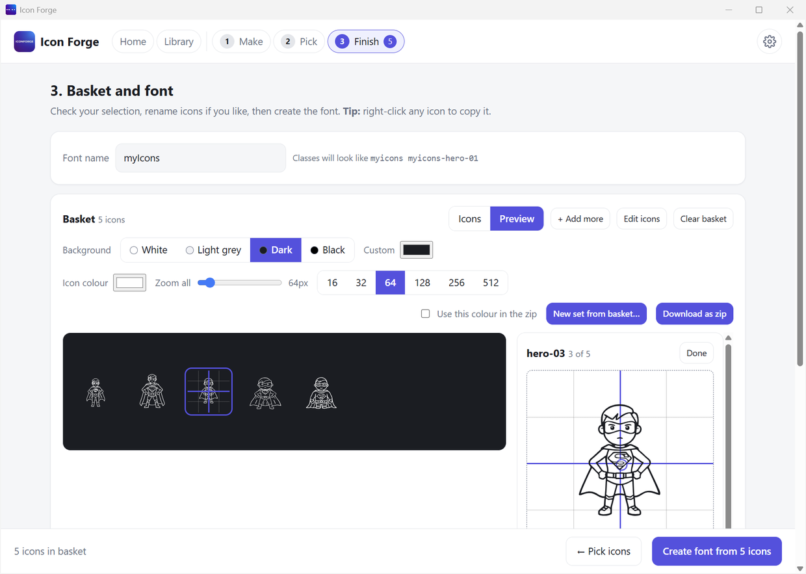

# Step 3: Basket and font

Check your icons. Name them. Preview them. Then make the font, or download the icons as a zip.

The basket has two tabs: **Icons** and **Preview**.

The basket is saved for you. If you close Icon Forge, your icons, their names, your edits and the font name are still here next time.

## The Icons tab

| What you see | What you can do |
|---|---|
| A tile for each icon | Click the **×** to take it out of the basket |
| A name under each icon | Click it and type a new name |
| A small **checkbox** on each tile | Tick several, then remove them all at once (see below) |
| **+ Add more** | Opens the [library](Library.md) to pick more icons |
| **Edit icons** | Flip, turn, resize or clean up icons. This is [optional](Step-3-Edit-SVGs.md). |
| **New set from basket…** | Saves all the icons as a new set in your [library](Library.md). It keeps your edits and your names. If you type the name of a set that already exists, the icons are added to it. The basket does not change. |
| **Download as zip** | Saves the icons and the font in a `.zip` (see below) |
| **Clear basket** | Takes every icon out of the basket. It asks first. The files stay in your library. |

**Names matter.** The name of each icon becomes its name in your font. `spaceman-01` becomes the class `myicons-spaceman-01`. Use short names with letters, numbers and dashes.

### Remove many at once

1. Tick the small checkbox on the tiles you want to remove. **Shift + click** a second checkbox to tick the whole run between two.
2. A bar appears at the top of the basket: **"3 selected · Select all 10 · Clear selection · Remove 3 from basket"**.
3. Press **Remove N from basket**.

You can also remove one icon by **right-clicking** it and choosing **Remove from basket**. Removing from the basket never deletes a file.

## The Preview tab

See your icons the way they will look. Change the background to check they work on dark pages too.

| Control | What it does |
|---|---|
| **Background** | White, Light grey, Dark or Black. Or pick any colour with **Custom**. |
| **Icon colour** | The colour of the icons. It switches to white on a dark background by itself, until you pick a colour yourself. |
| **Zoom all** slider and the quick buttons **16, 32, 64, 128, 256, 512** | Show all the icons small or very large. This only changes how you see them here. |
| **Tap an icon** | Opens a box where you can change just that one icon (see below) |
| **Use this colour in the zip** | Paints the icons in this colour in the zip file. Off by default. |
| **New set from basket…** | Saves the icons as a new set in your library |
| **Download as zip** | Saves the icons and the font as a zip |

### Change just one icon

**Tap an icon** in the preview. A box opens on the right. It changes only that icon. The others stay as they are. These are the same edits as in [Edit icons](Step-3-Edit-SVGs.md), so they go into the font and the zip.

| Control | What it does |
|---|---|
| **Drag the icon** in the box | Puts it where you want it. The **cross** marks the middle, and the icon snaps to it. |
| **◀ ▲ ▼ ▶** and **Centre** | Move it a little, or put it back in the middle. Hold **Shift** with the arrow keys for bigger steps. |
| **Size** slider | 50% to 200% |
| **Rotate** slider, the **−1°**, **−0.1°**, **+0.1°**, **+1°** buttons and the **Angle** box | Turn it to any angle |
| **⟲ 90°**, **⟳ 90°**, **↔ Flip**, **↕ Flip** | A quarter turn, or a mirror |
| **Fit to box** and **Reset** | Make it fill the box, or undo your changes |
| **Copy these edits to all N icons** | Gives every icon the same edits |
| **More in Edit icons →** | Opens [Edit icons](Step-3-Edit-SVGs.md) |
| **Done** | Closes the box |

Background, colour and zoom only change how you see the icons here. A font has no colour of its own. You set it with CSS `color`.

## Download as a zip

Press **Download as zip**. Windows asks where to save it. The zip is named after your font (for example `myicons.zip`).

- The zip has two folders.
- The **svg** folder has one `.svg` file for each icon, named like the icon in your basket.
- The **font** folder has the font files (`.ttf`, `.woff` and `.woff2`), the `.css` file and `preview.html`. Icon Forge makes the font for you when you press the button.
- If the font cannot be made, you still get the SVG icons, and a message tells you why.
- **Your edits are applied** (flips, size, position, deleted shapes).
- Two icons with the same name get `-2`, `-3` and so on.
- The saved prompt is **not** put in the files.
- With **Use this colour in the zip** ticked, the icons are painted in the preview colour.

## Make the font

| Step | What to do |
|---|---|
| 1 | In the **Font name** box at the top, type a name, like `myicons`. |
| 2 | Look at "Classes will look like…". That is how you will use it. |
| 3 | Press **Create font from N icons** at the bottom. |

It takes a few seconds. **← Pick icons** in the same bar goes back to [Step 2](Step-2-Pick-Icons.md).

## When it is done

A green box says **"Font created"**.

| Button | What it does |
|---|---|
| **Open preview.html** | Opens a page that shows every icon. You can search, resize and change colour. Click an icon to copy its class. |
| **Open folder** | Opens the folder with your font files |
| **Start a new set** | Asks first, then clears the basket and the keywords so you can begin again |

The box also shows two lines of code you can copy. See [Use your font](Use-Your-Font.md).

## Copy a single icon

You do not need a font to use an icon. **Right-click** any icon (in the library, Pick, Edit icons, the basket, the Preview or full screen) and choose:

| Choice | What you get on the clipboard | Paste it into |
|---|---|---|
| **Copy SVG** | The SVG code of the original icon | A code editor, a website, Figma, Illustrator |
| **Copy SVG with my edits** | The SVG code with your flips, size and deletions (shown only if you edited the icon) | The same places |
| **Copy as picture (PNG)** | A 512 px picture on a white background | Word, Slides, email, chat |

A small message says **"copied to clipboard"**. Then press **Ctrl+V** where you want it. The saved prompt is not included.

