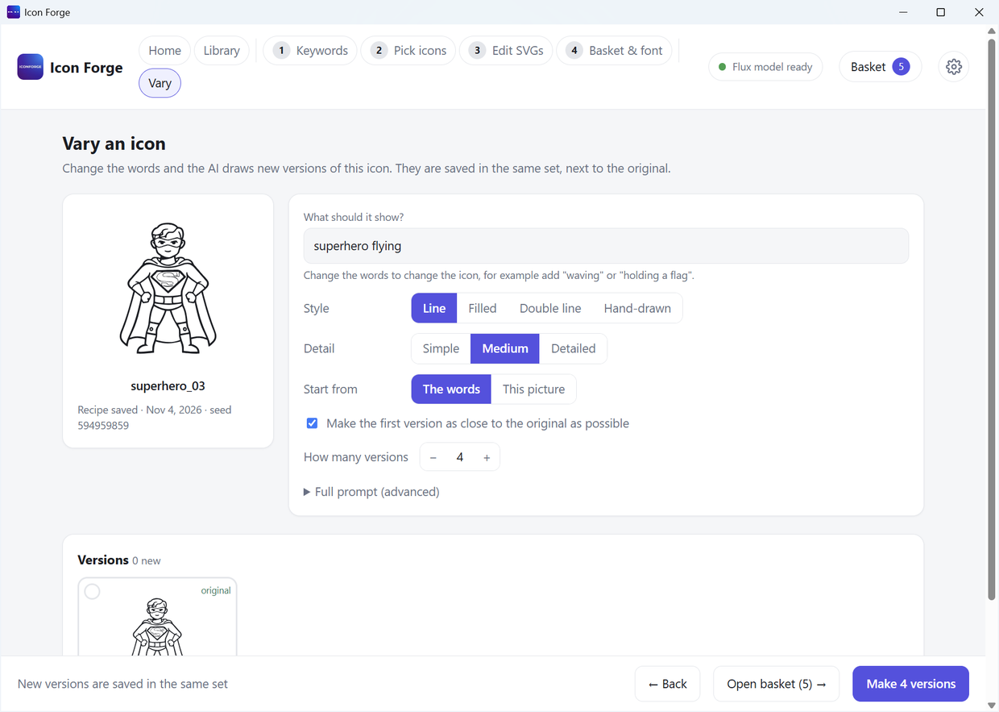
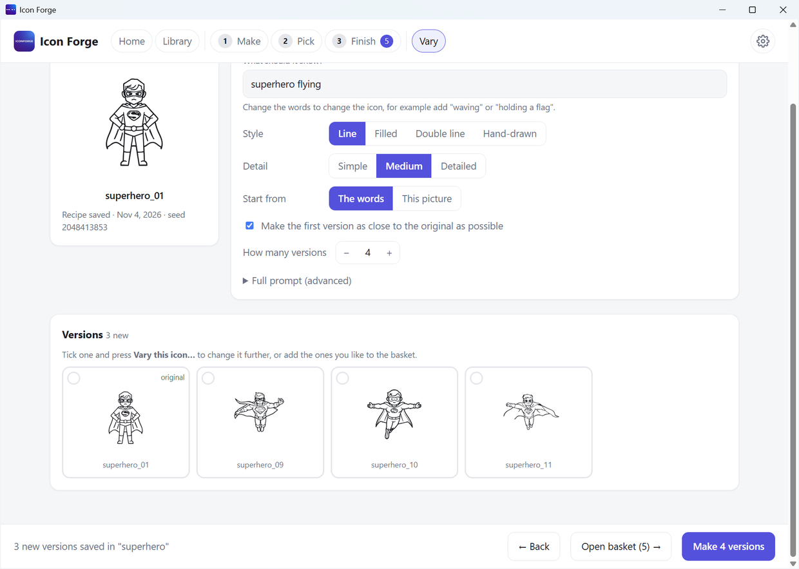

# Vary an icon

Like an icon but want it a little different? Pick it, change the words, and the AI draws new versions of it. The new versions are saved in the same set, next to the original.

## Open it

| Way in | How |
|---|---|
| From the library or Pick | Open a set (or go to the Pick step) and tick **one** icon. A **Vary this icon…** button appears in the bottom bar. |
| From full screen | Press **Vary this icon…** at the top of the full-screen view |
| With the mouse | **Right-click** any icon and choose **Vary this icon…** |
| From Edit icons | Press **Vary this icon…** under the icon you are editing |

## What you can change

| Setting | What it does |
|---|---|
| **What should it show?** | The words. Change `spaceman` to `spaceman waving` or `spaceman holding a flag`. This is the main control. |
| **Style** | Line, Filled, Double line or Hand-drawn |
| **Detail** | Simple, Medium or Detailed |
| **Start from** | **The words**: the AI draws from the words only. **This picture**: the AI starts from the icon itself and changes it. |
| **How much to change** | Only for **This picture**. Low keeps the shape and changes small things. High lets the AI redraw almost everything. |
| **Make the first version as close to the original as possible** | Only for **The words**. The first version uses the same seed as the original. |
| **How many versions** | 1 to 6 |
| **Full prompt (advanced)** | The exact text sent to the AI. It updates as you change the settings. If you edit it yourself, your text is used exactly. **Reset to automatic** goes back. |

## Make the versions

Press **Make N versions** in the bottom bar. A bar shows how far it has got, and how many versions did not finish. The first one takes longer if the model has to load.

- The original shows with an **original** label. The new versions are next to it.
- Tick any version to add it to your basket, or tick **one** and press **Vary this icon…** to change it further.
- Not happy? Press **Make N versions** again for more. Old versions are never overwritten.
- Press **■ Stop** to stop. Versions already drawn are kept.

## The recipe

Icon Forge saves the **recipe** of every new icon inside its own SVG file: the prompt, the style, the detail, the seed and the date. A version also remembers which icon it came from.

- The Vary screen reads the recipe. Your old icon's words and seed are filled in for you.
- Icons made before recipes were saved have none. The screen says so and makes a best guess from the set name. Correct the words if the guess is wrong.
- The recipe is left out when you **copy** an icon or **download a zip**, so you do not share your prompts by accident.

## Good to know

- Each version takes about 20 to 30 seconds on our test PC, once the model is loaded. Starting from **This picture** is a little slower.
- **This picture** with a low percent gives small changes. For a bigger change, raise the percent or change the words.
- The AI is not perfect. Some versions look odd. Make a few and keep the good ones.
